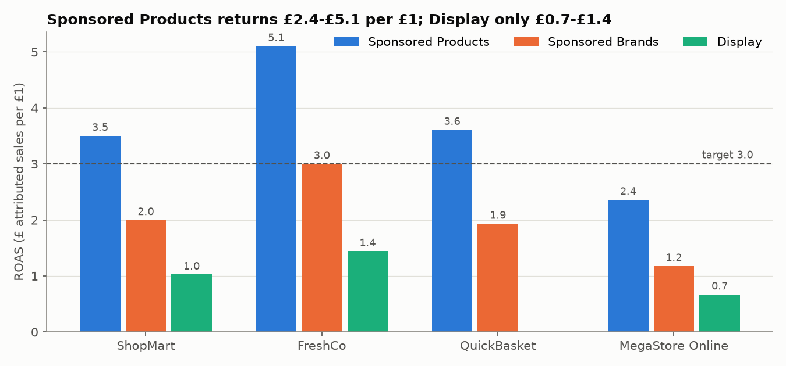

# Retail Media & Digital Shelf Analytics

An end-to-end commerce analytics project for a fictional snack brand, **Brightleaf**, sold through
four fictional online retailers. It covers the work a media & commerce data scientist does every week:
consolidating messy retailer exports, measuring media and digital shelf KPIs, finding what drives
sales, and turning that into budget and action recommendations for stakeholders.

> **Synthetic data.** All brands, retailers and numbers are generated by `mca/generate.py` to look like
> real retail media and digital shelf exports. The methods are real; the data is not.



## Business questions

1. Which retailers and ad types return the most per £1 of media, and where should budget move?
2. How much spend is wasted when products are out of stock?
3. Does better product page content increase conversion and sales?
4. How much is a top organic search position worth?
5. How competitive are our prices, and how strongly does price drive conversion?
6. What is our Share of Search, paid vs organic, by retailer and keyword?

## Headline findings (FY2025, synthetic)

| | Finding | Recommendation |
|---|---|---|
| 💷 | Blended ROAS 2.64 vs a 3.0 target. Sponsored Products returns £2.4-£5.1 per £1; Display returns £0.7-£1.4 | Reallocate at constant budget using fitted response curves: **about +10% attributed ad sales (~£43k)** |
| 📦 | **£8.0k (5.1%) of ad spend ran on out-of-stock days**, at ROAS 0.17 vs 2.78 in stock | Pause ads automatically on stock-outs; fix supply at QuickBasket (88% availability) |
| 📝 | Listings with upgraded content grew sales **+28%** vs unchanged listings (difference-in-differences) | Roll out content upgrades to all listings scoring under 70 |
| 🔎 | Top-3 organic rank sells 1.7x the units of rank 11+ | Protect rank: availability, content and reviews |
| 🏷️ | Price elasticity about -2.2; CVR falls from 42% to 22% as we move from >5% cheaper to >5% dearer than competitors | Monitor the price index weekly; flag SKUs above 1.05 |

The full write-up is in [`reports/insights.md`](reports/insights.md).

## What's inside

```
mca/
  config.py      fictional brand, retailers, SKUs, keywords, KPI targets
  generate.py    synthetic data with planted effects, written out as messy raw exports
  clean.py       consolidation of 4 media schemas + shelf/EPOS/search files into a star schema, with a data-quality log
  kpis.py        CTR, CPC, CPM, CVR, ROAS, ACoS, TACoS, availability, rank, content, price index, Share of Search, RAG
  analysis.py    OOS waste, content diff-in-diff, rank buckets, OLS sales driver model, response curves + budget optimiser
  report.py      charts, Excel scorecard, markdown insights report
run_pipeline.py  one command end to end
powerbi/         DAX measures + data model and 5-page dashboard build guide
reports/         insights.md, KPI_Scorecard.xlsx, figures/
data/raw/        retailer exports as they "arrive" (different columns, date formats, currency strings, duplicates)
data/processed/  clean star schema (fact_media, fact_shelf, fact_sales, fact_search, dim_*)
tests/           21 pytest tests: KPI maths, cleaning rules, schema integrity, planted effects recovered
```

### Data consolidation

Each retailer's media export arrives in a different shape, e.g. `Spend (GBP)` vs `cost` as `"£1,234.50"` vs `Spend`;
`2025-01-31` vs `31/01/2025` vs `31-Jan-2025`; upper vs lower-case SKUs. The cleaning step maps all four
to one schema and logs every fix:

| Source | Issue | Rows |
|---|---|---:|
| media_megastore_online.csv | exact duplicate rows removed | 119 |
| media_megastore_online.csv | negative impressions removed | 12 |
| media_megastore_online.csv | missing sales set to 0 | 30 |
| digital_shelf_export.csv | retailer names standardised (13 spellings → 4) | 16,294 |
| digital_shelf_export.csv | duplicate daily captures removed | 117 |
| digital_shelf_export.csv | missing ratings filled from previous capture | 467 |

### Excel KPI scorecard (`reports/KPI_Scorecard.xlsx`)

- **Retailer Scorecard:** headline KPIs with Red/Amber/Green status against targets
- **Summary (formulas):** live `SUMIFS` over a structured Excel table, with a month dropdown (data validation)
- **SKU Shelf Health:** 64 SKU x retailer rows, colour scales, filters and an auto-generated action column
- **Budget Reallocation:** response-curve fit, marginal ROAS and recommended spend per cell
- **Data Quality:** the cleaning log

### Power BI

`data/processed/` is a ready-to-load star schema. [`powerbi/measures.dax`](powerbi/measures.dax) has the
measures (ROAS, TACoS, OOS ad spend, Share of Search, RAG colours), and
[`powerbi/README.md`](powerbi/README.md) sets out the relationships and a 5-page report:
Executive Overview, Media Performance, Digital Shelf Health, Share of Search and SKU Drill-through.

## Methods

- **KPIs as ratios of sums** at the reporting grain, never averages of daily ratios.
- **Out-of-stock waste:** media joined to daily availability at date x retailer x SKU.
- **Content effect:** listings whose content score rose 10+ points mid-year are compared with unchanged
  listings before and after (difference-in-differences on indexed daily units and on ad CVR).
- **Sales driver model:** OLS on log daily units with log organic rank, log price index, rating and content
  score, controlling for retailer, category and month.
- **Media response curves:** `ad_sales = a · spend^b` fitted per retailer x ad type. Marginal ROAS = b x ROAS.
  A greedy optimiser moves budget from low to high marginal ROAS, keeping total spend fixed and each cell within ±30%.
- **Caveats:** attributed ad sales are not incremental sales (validate with a holdout test), and the regression
  shows associations, not causal effects.

## Run it

```bash
pip install -r requirements.txt
python run_pipeline.py        # generate -> clean -> analyse -> report (a few seconds)
python -m pytest              # 21 tests
```

**Tools:** Python (pandas, NumPy, matplotlib, openpyxl), Excel, Power BI / DAX, pytest.
