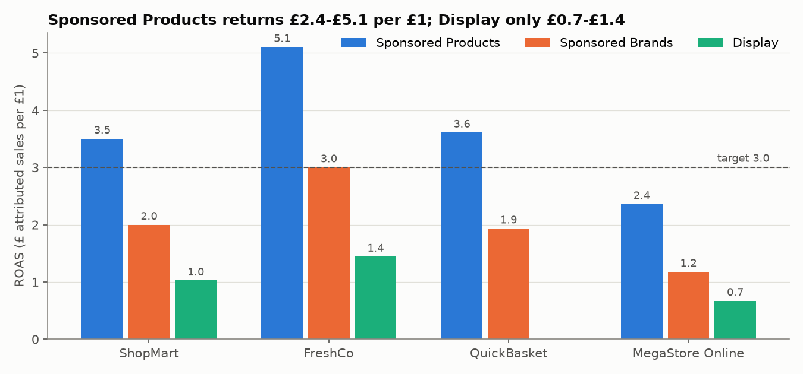
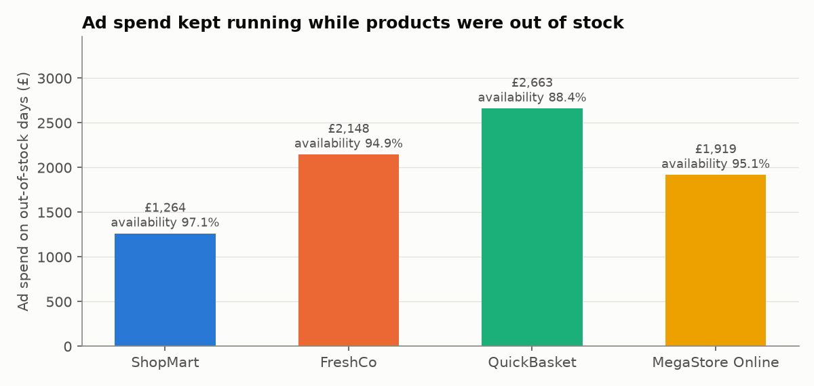
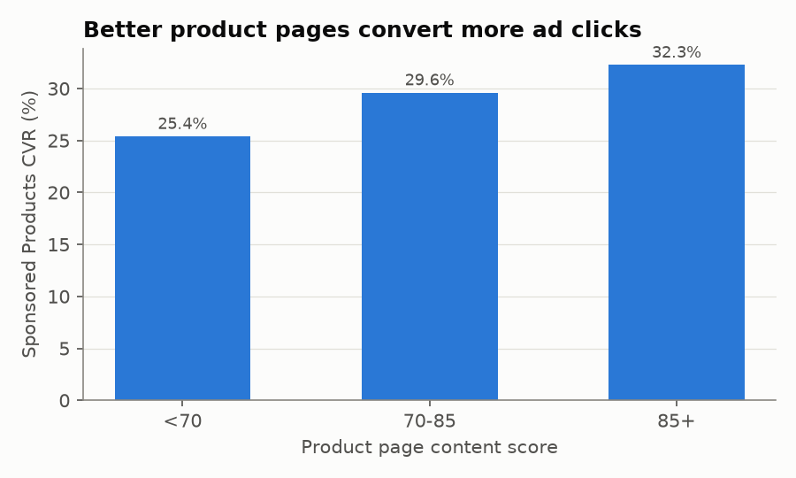
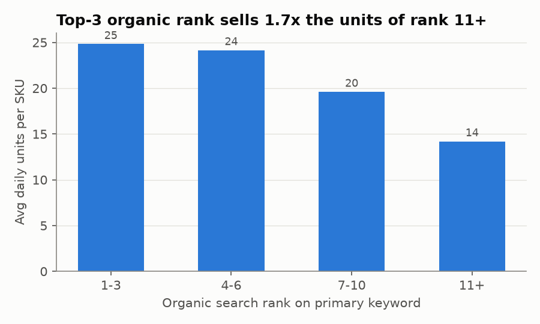
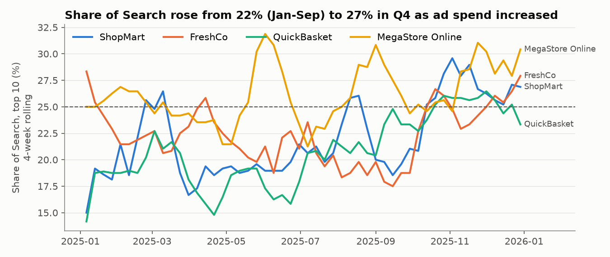
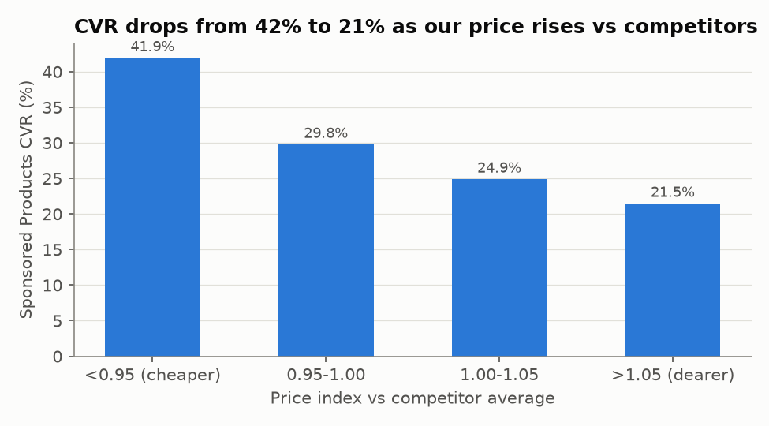
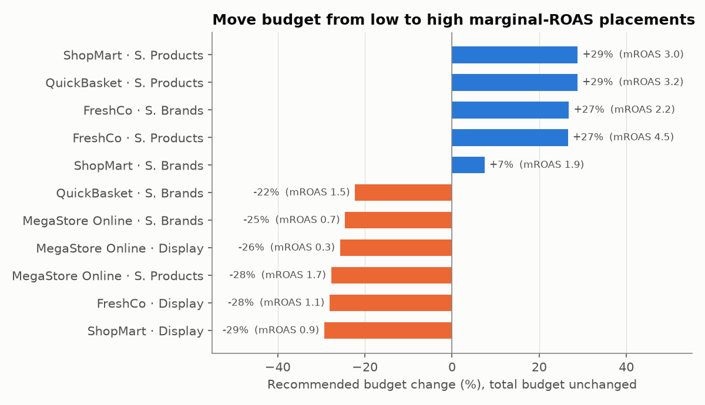

# Brightleaf: Retail Media & Digital Shelf Performance Review (FY2025)

> **Synthetic data.** Brightleaf and all retailers are fictional. The data was generated to
> mirror real retail media and digital shelf exports so the analysis methods can be shown end to end.

## Executive summary

Brightleaf sold **£916,451** across four online retailers in 2025 and spent **£155,330** on
retail media (TACoS 16.9%). Blended ROAS was **2.64** against a 3.0 target,
with CTR 0.46%, CPC £0.48 and CVR 21.3%.
Share of Search averaged **23.0%** (paid 36.1%, organic 17.4%),
below the 25% target.

**Five recommendations**

1. **Reallocate media budget at constant spend: about +10% attributed sales (£42,974).**
   The best marginal return is FreshCo Sponsored Products (mROAS 4.5); the weakest is
   MegaStore Online Display (mROAS 0.3). Increase: ShopMart Sponsored Products (+29%), QuickBasket Sponsored Products (+29%), FreshCo Sponsored Brands (+27%), FreshCo Sponsored Products (+27%), ShopMart Sponsored Brands (+7%). Reduce: ShopMart Display (-29%), FreshCo Display (-28%), MegaStore Online Sponsored Products (-28%), MegaStore Online Display (-26%), MegaStore Online Sponsored Brands (-25%), QuickBasket Sponsored Brands (-22%).
2. **Pause ads automatically when a SKU is out of stock: saves £7,994 a year (5.1% of spend).**
   ROAS on out-of-stock days was 0.17 vs 2.78 in stock. QuickBasket wasted the most
   (£2,663); its availability needs a supply fix as well.
3. **Roll out the content upgrade programme.** The 5 listings upgraded in July grew sales
   **+28%** more than unchanged listings (difference-in-differences), and ad CVR rose
   +5.0 pts. Listings scoring under 70 convert at 25.4% vs 32.3% for 85+.
4. **Protect organic rank.** Top-3 organic positions sell **1.7x** the units of rank 11+. Out-of-stock spells push rank
   down, so fixing availability also protects organic visibility.
5. **Watch price gaps.** Sponsored Products CVR falls from 41.9% when we are >5% cheaper than competitors to
   21.5% when we are >5% dearer. The driver model gives a price elasticity of -2.2.

## Retailer scorecard

| Retailer | Sales | Ad spend | ROAS | Availability | Share of Search | Content | Price index |
|---|---:|---:|---:|---:|---:|---:|---:|
| ShopMart | £288,749 | £47,941 | 🔴 2.49 | 🟢 97.1% | 🔴 22.3% | 72 | 1.014 |
| FreshCo | £270,689 | £40,207 | 🟢 3.64 | 🟠 94.9% | 🔴 22.4% | 69 | 0.974 |
| QuickBasket | £138,605 | £23,178 | 🟢 3.11 | 🟠 88.4% | 🔴 21.0% | 68 | 1.040 |
| MegaStore Online | £218,409 | £44,005 | 🔴 1.64 | 🟢 95.1% | 🟢 26.3% | 74 | 1.001 |

🟢 meets target · 🟠 within 10% · 🔴 more than 10% off. Full detail, a formula-driven summary and SKU-level actions are in
`KPI_Scorecard.xlsx`.

## Findings

### 1. Media effectiveness by retailer and ad type

### 2. Out-of-stock ad waste

### 3. Content quality and conversion

### 4. Organic rank and sales

### 5. Share of Search

### 6. Price competitiveness

### 7. Budget reallocation

Each retailer x ad type cell has a fitted response curve, ad sales = a · spend^b, from daily in-stock data. Marginal ROAS
(b x ROAS) is the return on the next £1. A greedy optimiser moves budget from the lowest to the highest marginal ROAS,
keeping total spend fixed and each cell within ±30% of today's spend so it does not extrapolate beyond observed data.

## Sales driver model

OLS on log daily units (in-stock days, n = 21,932, R² = 0.51), controlling for retailer,
category and month:

| Driver | Effect | Std. error |
|---|---:|---:|
| Organic rank (elasticity: % sales change per 1% worse rank) | -0.30 | 0.013 |
| Price index vs competitors (price elasticity) | -2.17 | 0.038 |
| Star rating (% sales change per +1 star) | +142% | 0.013 (log scale) |
| Content score (% sales change per +10 points) | +12% | 0.004 (log scale) |

## Method and caveats

- **Pipeline:** 4 retailer media exports with different schemas, a digital shelf export, EPOS sell-out and weekly search
  snapshots, consolidated into a star schema (`data/processed`) that feeds both this report and Power BI.
- **Attributed is not incremental.** Retailer-attributed ad sales overstate true incrementality. Validate the reallocation
  with a geo or retailer-level holdout test before scaling it.
- **Observational model.** The driver coefficients are associations with controls, not causal effects. The content
  difference-in-differences is the strongest causal evidence here.
- **Response curves** use daily variation in spend. Big moves outside the observed spend range need testing.
